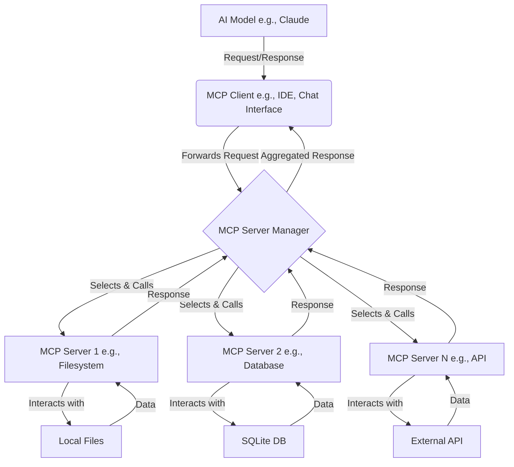

The Model Context Protocol (MCP) is an open standard designed to allow AI models, like Anthropic's Claude, to securely interact with local and remote resources. This unlocks a vast potential for AI assistants to perform complex tasks, access specific data, and integrate with various tools and services. For developers, MCP transforms AI agents from basic chat assistants into powerful coding partners that can understand codebases, interact with repositories, analyze data, and help troubleshoot complex issues. By giving AI agents the ability to "see" and interact with your development environment, they can provide more contextual, accurate, and actionable assistance. In this post, we'll dive into how you can configure MCP servers to supercharge your AI interactions.

{/* <ArticleImage src={"/static/images/blog/mcp-overview.png"} alt={"MCP Overview Diagram"}/> */}



## Understanding MCP and Runtimes

At its core, MCP enables a structured way for AI models to request actions or information from external "servers." These servers can be simple scripts or more complex applications that provide access to file systems, databases, version control, web browsers, and much more.

When configuring MCP servers, you'll often encounter commands that utilize runtimes like Node.js (via `npx`) or Python (potentially via tools like `uvx`).

*   **`npx`**: This is a package runner tool that comes with npm (Node Package Manager). It allows you to execute Node.js packages without having to install them globally or in your project. This is very handy for running MCP servers that are distributed as npm packages.
*   **`uvx`**: While `uvx` might be less universally known than `npx`, it serves a similar purpose in the Python ecosystem. `uv` is a fast Python package installer and resolver, and `uvx` could refer to its command for executing packages. It helps in managing Python-based MCP servers and their dependencies.

## My MCP Server Configuration Example

Let's look at a practical example of an MCP server configuration. This JSON structure defines several servers, their commands, arguments, and whether they are enabled:

```json
{
  "mcpServers": {
    "browser-tools": {
      "command": "cmd /c npx @agentdeskai/browser-tools-mcp",
      "enabled": true
    },
    "sqlite": {
      "command": "cmd /c npx mcp-server-sqlite-npx",
      "args": ["c:/repos/bucketly/prisma/.dev.db"],
      "enabled": true
    },
    "sequential-thinking": {
      "command": "cmd /c npx @modelcontextprotocol/server-sequential-thinking",
      "enabled": true
    },
    "memory": {
      "command": "cmd /c npx @modelcontextprotocol/server-memory",
      "enabled": true
    },
    "git": {
      "command": "uvx",
      "args": ["mcp-server-git", "--repository", "c:/repos/bucketly"],
      "enabled": true
    }
  }
}
```

In this configuration:
*   Each key under `mcpServers` (e.g., `"browser-tools"`, `"sqlite"`) is a unique identifier for that server.
*   `"command"`: Specifies the command to run the server. Notice the use of `cmd /c npx` for Node.js based servers and `uvx` for a Python-based one.
*   `"args"`: An array of arguments passed to the command. For example, the SQLite server is pointed to a specific database file, and the Git server is pointed to a repository path.
*   `"enabled"`: A boolean to easily toggle servers on or off.

## Brief Overview and Use Cases of Configured Servers

Let's explore what these configured servers can do:

1.  **`browser-tools`**:
    *   **Overview**: Provides the AI with capabilities to interact with a web browser.
    *   **Use Cases**:
        *   **Network Inspection**: Check network requests and responses for a webpage.
        *   **Screenshots**: Capture a screenshot of a specific URL or the current page.
        *   **Content Extraction**: Get the text content or HTML of a page.
        *   **Automated Navigation**: Programmatically navigate to URLs, click elements, and fill forms (use with caution!).

2.  **`sqlite`**:
    *   **Overview**: Allows the AI to connect to and interact with an SQLite database.
    *   **Use Cases**:
        *   **Data Analysis**: Query the database to retrieve specific data sets for analysis or reporting.
        *   **Bulk Updates**: Perform batch updates, insertions, or deletions based on AI-driven logic.
        *   **Schema Exploration**: Understand the structure of a database by querying its schema.

3.  **`git`**:
    *   **Overview**: Integrates with a Git version control repository.
    *   **Use Cases**:
        *   **Recent History**: Check the latest commits, commit messages, and changed files.
        *   **Branch Information**: List branches, check the current branch, or compare branches.
        *   **File Status**: See uncommitted changes or the status of specific files.

4.  **`sequential-thinking`**:
    *   **Overview**: As described, this server implements a tool for dynamic and reflective problem-solving. It helps the AI break down complex problems into manageable steps, revise its thinking, and explore different reasoning paths.
    *   **Use Cases**:
        *   **Complex Problem Decomposition**: When faced with a multi-faceted problem, the AI can use this tool to outline steps, consider variables, and form a coherent plan.
        *   **Drafting Content**: For writing articles or reports, it can iterate on sections, refine arguments, and ensure logical flow.
        *   **Debugging Scenarios**: When trying to diagnose an issue, the AI can use sequential thoughts to propose hypotheses, test them, and narrow down the cause.
        *   **Creative Brainstorming**: Exploring different angles of a creative task by branching out with new ideas from a central thought.

5.  **`memory`**:
    *   **Overview**: This server provides a basic persistent memory using a local knowledge graph. It allows the AI to remember information about the user and interactions across different chat sessions.
    *   **Use Cases**:
        *   **Personalization**: Remembering user preferences, past topics of discussion, or specific details the user has shared (e.g., "John\_Smith speaks fluent Spanish").
        *   **Contextual Continuity**: Maintaining context over extended projects or conversations by recalling previously established facts or decisions.
        *   **Relationship Mapping**: Building a simple understanding of how different entities (people, organizations, projects) mentioned by the user relate to each other. For instance, if a user mentions working at "Acme Corp" on "Project X", the memory server can store `(user) --works_at--> (Acme Corp)` and `(Acme Corp) --has_project--> (Project X)`.

## MCP Brave Search: Internet Access for Your AI

Another powerful MCP server worth mentioning is one that integrates with Brave Search (or other search engines). This grants your AI assistant access to the internet to fetch real-time information, look up facts, or find documentation. This is incredibly useful for tasks requiring up-to-date knowledge beyond the AI's training data. You can typically find such servers or build your own to call a search API.

## Risks and Considerations

While MCP servers offer immense power, it's crucial to be aware of the potential risks:

*   **Data Leaks**: Servers that interact with sensitive local files, databases, or internal services could inadvertently expose data if not configured or used carefully. Always review the permissions and access scope of each server.
*   **Irreversible Operations**: Some servers might perform actions with lasting consequences, such as file deletions, database modifications, or executing system commands. Ensure you understand what a server *can* do before enabling it, especially those with broad permissions.
*   **Security of Server Implementations**: Only use MCP servers from trusted sources. A maliciously crafted server could pose a significant security risk.
*   **Resource Consumption**: Some servers might be resource-intensive. Monitor their performance and impact on your system.

### Security Vulnerabilities

A concerning security analysis titled ["MCP: May Cause Pwnage - Backdoors in Disguise"](https://blog.jaisal.dev/articles/mcp) from April 2025 highlighted several critical vulnerabilities in MCP servers and related tools. While some of these issues have been addressed since publication, they illustrate the importance of careful MCP server configuration:

1. **Network Binding Issues**: Many MCP servers were found to bind to `0.0.0.0` (all network interfaces) rather than `127.0.0.1` (localhost only), potentially exposing them to external network access.

2. **Command Execution via GET Requests**: Some debugging tools like the MCP Inspector were vulnerable to Cross-Site Request Forgery (CSRF) attacks that could trigger command execution through simple GET requests.

3. **Browser-Based Attacks**: Publicly exposed MCP servers with browser automation capabilities (like the one we configure with `@agentdeskai/browser-tools-mcp`) could be exploited to access local files via the `file://` protocol.

4. **Git-Related Vulnerabilities**: Git-based MCP servers were found vulnerable to argument injection attacks that could lead to remote code execution.

To mitigate these risks:

* Always run MCP servers that bind only to localhost (`127.0.0.1`)
* Keep your MCP servers and related tools updated to the latest versions
* Be cautious when enabling servers with access to sensitive resources or capabilities
* Consider using a firewall to restrict access to MCP-related ports
* Avoid exposing MCP servers to the public internet

## Global vs. Project-Specific Servers

MCP server configurations can often be managed at different levels:

*   **Global Servers**: These are typically configured in a central location for your user profile and are available to the AI assistant across all projects or contexts. The `mcp-get` tool, for example, often manages a global list of available servers.
    *   You can usually list your globally installed/managed servers using a command like:
        ```bash
        npx @michaellatman/mcp-get@latest list
        ```
*   **Project-Specific Servers**: As shown in my example configuration, you might define a set of servers relevant only to a particular project or workspace. This allows for a tailored set of tools for the specific task at hand. This configuration is often placed in a file like `mcp-servers.json` or `.mcp_servers.json` within the project directory.

It's common for AI environments that support MCP to first look for a project-specific configuration and then fall back to or merge with the global configuration.

## Conclusion

Configuring MCP servers transforms your AI assistant from a general-purpose tool into a highly specialized and capable partner. By carefully selecting and setting up servers like those for browser interaction, database access, version control, structured thinking, and memory, you can significantly enhance your productivity and the range of tasks your AI can handle. Always prioritize security and use servers from trusted sources.

## Useful Resources

*   **mcp-get**: A CLI tool for installing and managing MCP servers. [https://mcp-get.com/](https://mcp-get.com/)
*   **Awesome MCP Servers List (appcypher)**: A curated list of MCP servers. [https://github.com/appcypher/awesome-mcp-servers](https://github.com/appcypher/awesome-mcp-servers)
*   **Awesome MCP Servers List (punkpeye - fork with potential additions)**: Another list, potentially a fork with more servers. [https://github.com/punkpeye/awesome-mcp-servers](https://github.com/punkpeye/awesome-mcp-servers)

Happy configuring! 